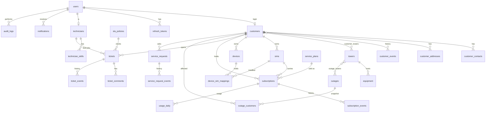

# Database shape

The SQLAlchemy models in `app/models/` are the schema. `alembic/versions/0001_initial.py` creates every table from those models.

A few decisions that are easy to miss:

- The plan on a SIM is the open **subscription**, not a second copy of `plan_id` on `sims`.
- `outage_customers` is a snapshot taken when the outage opens.
- `usage_daily` is one row per SIM per date. Monthly totals are a sum.
- Customers and plans use `deleted_at` (soft delete). A SIM uses the status `deactivated` instead, because that word is the business state.
- Quota columns: `0` means not included, `-1` means unlimited.
